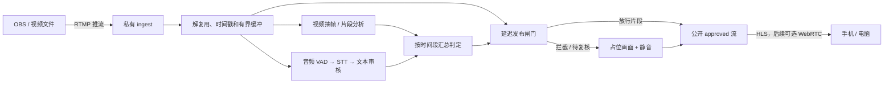

# EdgeLiveGuard：OBS 直播音视频审核网关规划书

> 规划日期：2026-11-14。本文是拟实施方案，不代表审核模型或放行链路已经部署。项目面向嵌入式 Linux / C++ 求职展示，初期以单路直播为目标。

## 1. 项目目标与边界

OBS 将屏幕、视频文件或其他直播源的 **H.264 视频 + AAC 音频**通过 RTMP 推入 Orange Pi 5 Pro（RK3588S、16 GiB）。板端先缓存并审核对应时段的音视频；只有得到明确放行决定的时段，才进入观众可访问的直播地址。观众用手机或电脑观看。**不依赖板载摄像头、麦克风或耳机。**

项目的价值是把媒体服务、音视频同步、实时推理、策略决策和可靠性工程串成可验证的系统。它不是“加载几个模型就能自动判断一切”的演示。每一种违规类别都要定义边界、准备有授权的测试样本、测量误报漏报，并在无法确定时走人工复核或安全占位画面。

**第一版验收范围**：1 路 OBS 推流、私有输入、带延迟的审核闸门、审核通过后手机/电脑播放；先接入一个可评测的视频类别和一个有明确规则的语音类别。抽烟、特定手势、暴力和血腥等逐项扩展，不把未经评测的模型输出称为可靠判定。

## 2. 用户流程与板卡角色

板卡是**边缘直播审核与分发网关**，不是摄像头。OBS 可以从游戏画面、桌面、采集卡或循环播放的合法测试素材取得视频和音频。RTMP 负责 OBS 推入；HLS 适合第一阶段的手机/浏览器播放；RTSP、RTMP 也可用于工程调试或专业播放器。WebRTC 可作为后期低延迟播放选项，但审核缓冲本身会引入必要延迟。

关键安全边界：`ingest` 只能由授权推流者和审核程序访问，**观众不能直接拉原始流**。观众只能访问 `approved`。优先把输入与输出放在独立媒体服务实例或隔离的监听面，再用发布/播放鉴权 hook、HTTP 访问控制和防火墙交叉验证；启用 HLS 后尤其要测试原始流是否能经 HTTP 路径绕过限制。正式部署还要控制管理 API 的访问。

## 3. “先审核，后发布”的工作方式

1. 输入流按 PTS 对齐音频和视频，进入有界缓冲。初始设计目标是约 **10–15 秒安全延迟**，最终数值由最长语音分段、推理 P95 时间和播放器延迟实测决定，不预先承诺固定时延。
2. 视频在缓冲期间抽帧或组成短片段分析；音频先做 VAD 和语音识别，再结合相邻句子判断。每个判定都有时间范围、类别、分数、模型版本和决策原因。
3. 闸门以可播放的片段/GOP 边界发布。`allow` 才放行；`block` 和 `review` 输出占位画面与静音，必要时终止该路直播。超时、模型崩溃、缓冲溢出、时间戳异常按 **默认不放行** 处理，同时记录原因和报警。
4. 转换成占位片段时需要维护连续时间戳和音视频同步。编码格式/GOP 必须兼容；必要时重编码替换时段并测量 CPU 开销。被拦截的原始音视频不能通过其他协议、路径或回看地址泄漏。

“没有问题再推送”意味着发布者到观众之间一定有延迟；如果要求接近实时，必须接受更短审核上下文带来的漏检风险。原始流**直接转发后异步报警**无法满足本项目的放行约束。

## 4. 审核能力的实施顺序

| 内容 | 初期方法 | 主要难点与验收要求 |
| --- | --- | --- |
| 裸露 / 成人画面 | 候选 ONNX 图像检测模型（如 NudeNet），抽帧、连续帧确认 | 明确什么画面要拦截；肤色、泳装、医疗场景会带来误报；检查模型许可和自有测试集效果 |
| 语音中的明确违规表述 | 复用现有 SenseVoice STT + Silero VAD；文本规则与小模型/人工复核 | 方言、背景音乐、识别错误、引用和否定句；先定义具体内容规则，再测 CER 与分类错误 |
| 吸烟 | 人、手、香烟/烟雾检测并结合短时跟踪 | 远距离小目标、雾气、道具；通常需要场景数据和专门训练 |
| 特定违规手势 | 先定义手势清单，再做手/人体关键点与时间序列分类 | 仅靠单帧目标检测不够；遮挡与视角变化影响大 |
| 暴力行为 / 血腥画面 | 分开处理：片段级动作识别与图像级血腥识别 | “打斗”和“血腥”不是同一任务；游戏、电影、体育场景需独立评测 |
| 音视频联合判断 | 将语音文本和画面按时间对齐，提供辅助证据 | 放在单模态基线之后，避免复杂度掩盖单模型误差 |

“涉政”“宗教”这类宽泛词汇不直接作为自动封禁标签。需要先依据适用的产品规则写出**具体、可复核的违规定义**；普通讨论、新闻引用、宗教介绍不能仅因出现关键词而拦截。有争议或低置信度内容标为 `review`，保留人工复核通道。候选文本审核模型如 Qwen3Guard 可以用于对照评测，但其公开任务主要是提示词/模型回复安全分类，不能直接把其指标当作直播语音审核指标。

模型选择顺序是：先用可运行的 CPU/ONNX 基线测准确率与时延，再验证 RKNN 转换及板端驱动，最后考虑 NPU 加速。不能因板子有 `librknnrt.so` 就宣称 NPU 已验收。16 GiB 内存有利于单路原型，但实际路数由解码、模型、缓冲、温度和持续负载测试决定。

## 5. 技术方案与代码边界

| 部分 | 方案 | 本仓库的工程工作 |
| --- | --- | --- |
| 媒体接入与分发 | 固定版本的 [ZLMediaKit](https://github.com/ZLMediaKit/ZLMediaKit) 接收 OBS RTMP 并提供播放协议；使用[发布/播放 hook](https://github.com/zlmediakit/ZLMediaKit/wiki/MediaServer%E6%94%AF%E6%8C%81%E7%9A%84HTTP-HOOK-API)控制私有输入与公开输出 | 配置生成、鉴权与回归测试；不重写 RTMP/RTSP 协议栈 |
| 审核主程序 | C++17/20、CMake；FFmpeg 或 GStreamer 解复用/编解码 | 有界缓冲、PTS 对齐、分析调度、状态机、片段放行/替换、断流恢复、模型接口、指标 |
| 语音 | 复用现有 [speech-translation-gateway](../../speech-translation-gateway/README.md) 的 VAD/STT 经验与组件 | 将直播音轨送入 STT；语音分类和决策逻辑另行实现，不依赖板载麦克风或 TTS |
| 视觉 | ONNX Runtime/现有 C++ 推理适配；后期参考 [RKNN Model Zoo](https://github.com/airockchip/rknn_model_zoo) | 模型输入预处理、时间聚合、分类决策、误差评测、板端性能对照 |
| 控制与观测 | Drogon 或轻量 HTTP API、Prometheus 文本指标、systemd | 流状态、审核事件、队列深度、超时/拦截原因、健康检查和配置校验 |

原有板端 ZLMediaKit 完成过[合成视频的 RTSP/RTMP 回环](streaming_board_smoke.md)，仍保留作回退。新增的[传输闸门 MVP](live_gate_mvp.md)与独立 HLS 实例已完成合成流和 OBS 推流验证，虚拟机上也有[Qt 单路播放器](../qt-viewer/README.md)；当前判定只有模拟放行/拦截，没有 AI 内容审核。现有 `veg_gateway` 是独立的越线事件原型，可提供采集、事件与指标模块的工程经验。

## 6. 分阶段交付与验收

| 阶段 | 交付物 | 可复现验收 |
| --- | --- | --- |
| 0. 规则与测试集 | 可配置的类别定义、许可核对、合法/违规/边界样本清单和标注格式 | 每个样本有来源、时间范围和预期动作；模型/素材不提交 Git |
| 1. 媒体闸门 MVP | OBS → 私有 RTMP → C++ 有界延迟缓冲 → 模拟 `allow/block/review` → 公开 HLS | 手机/电脑只可播放 approved；阻断 ingest 直连；用带时间戳的测试流验证替换片段和 A/V 同步 |
| 2. 语音审核 | VAD/STT、文本规则、上下文窗口和人工复核事件 | 公开测试语料的 CER、分类精确率/召回率；超长语音与静音、噪声、混合音乐的处理 |
| 3. 视觉审核 | 先评测裸露类别，再逐项加入吸烟、手势、暴力/血腥 | 按类别给出独立混淆矩阵、误报/漏报案例；未经达标的类别保持试验状态 |
| 4. 板端优化与稳定性 | 解码路径与 RKNN 可用性核验、压力与故障注入、运维文档 | 单路持续 24 小时，再扩展到 72 小时；温度、RSS、延迟、超时、恢复时间和拦截泄漏测试报告 |
| 5. 求职展示 | 架构图、部署脚本、OBS 设置、演示视频、数据/模型来源与测试报告 | 从干净环境复现；清楚说明第三方组件、本仓库代码、已达到与未达到的指标 |

第一阶段最重要的验收是**任何未审核或审核失败的片段都无法从观众地址取到**。它可以用模拟判定先验证，与模型准确率分开测。功能完成后再考虑多路并发和低延迟协议。

按单人业余开发估计，可先给阶段 0–1 预留 3–4 周、阶段 2 预留 2–3 周、阶段 3 的首个视觉类别预留 2–4 周、阶段 4–5 预留 2–3 周。时间是排期参考，不是已完成进度；吸烟、手势、暴力/血腥取决于合适数据与评测结果，单独排期。

## 7. 指标、测试和运行约束

- **审核质量**：每类 Precision、Recall、F1、每小时误拦次数、漏放片段数；先在带标注的保留测试集上报告，不能用“零漏检”宣称普遍安全。
- **语音链路**：STT 的 CER/WER、从发声到文字/决策的 P50/P95 时间；区分识别错误和策略分类错误。
- **媒体链路**：OBS 到观众的端到端 P50/P95 延迟、A/V 同步偏差、卡顿、丢帧、首帧时间、断线恢复时间。
- **系统链路**：缓冲占用、队列长度、推理超时、CPU/NPU/RSS/温度、磁盘写入、客户端并发和 24/72 小时稳定性。过载时始终优先保证不误放行。
- **测试策略**：C++ 单元测试验证时间戳、状态机和队列边界；合成带时间码的音视频回放验证端到端；模型评测使用分离的训练/验证/测试集；故障注入覆盖断流、超时、模型退出、满队列、重启和网络抖动。
- **数据与日志**：模型权重、音视频、录音、密钥、构建产物不入库。板端不长期留存原始直播或高频日志；部署后仍按既有约定把必要运行日志写到 Windows `E:\orange Pi 5 Pro\log`，主机离线时采用有界缓存和丢弃策略。事件证据需要明确授权、脱敏与保留期限。
- **硬件**：板端此前无散热，长时间运行测试前需装散热并量温。磁盘约 57 GB，模型与缓存设置上限。当前音频翻译服务与新服务需隔离资源，避免互相影响。

## 8. 当前状态与下一步

**已有**：OBS 实际 H.264/AAC 推流；板端接收专用 RTMP 端口、C++ 有界延迟缓冲、模拟 GOP 拦截；独立 ZLMediaKit 的 HLS/RTSP 输出；虚拟机 Qt/GStreamer 单路播放。合成流验证中，拦截颜色和对应音频未出现在抽样客户端结果中。**尚无**：真正的 AI 内容审核、`review`/占位片段、公开输出的推流鉴权、手机浏览器实机播放、准确率和长时间稳定性报告。

下一步先补上公开输出的发布鉴权与 `review`/占位片段，做断流、超时、缓冲溢出和多客户端回归；随后用可重复的测试集接入审核模型。摄像头型号和 CSI 驱动不是该项目的前置条件。

后续做真人/真实直播验收时，需要 OBS 输出的一路可控测试流、可使用的音视频样本及其授权、明确的审核规则。开展板端持续负载测试前还需要散热。阶段 1 可以先用生成素材独立推进。
